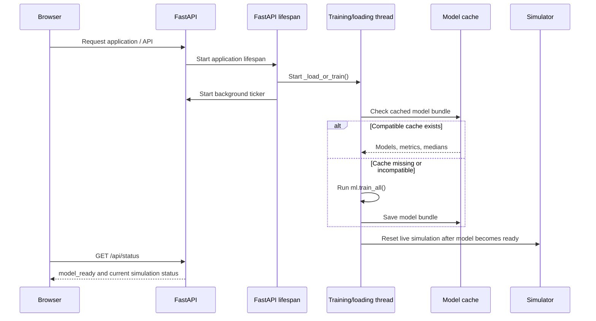
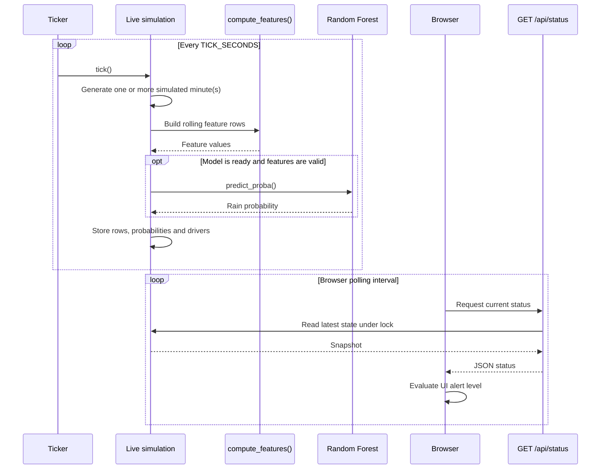
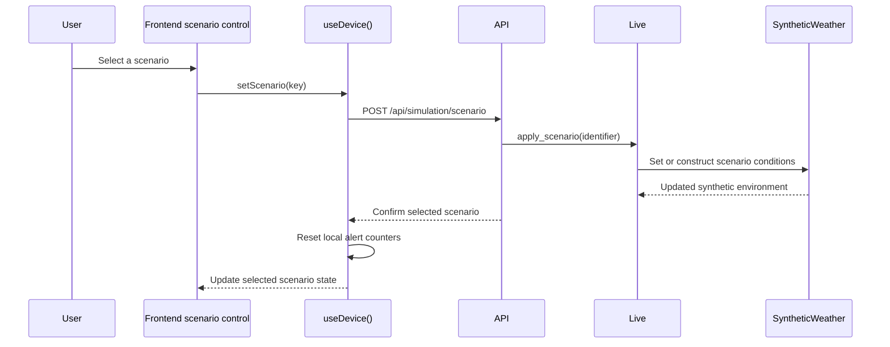
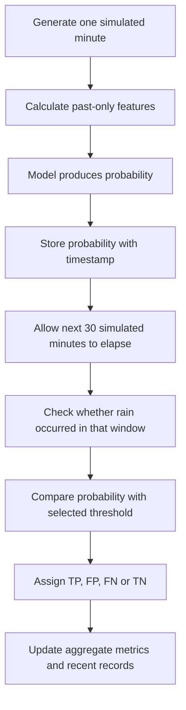
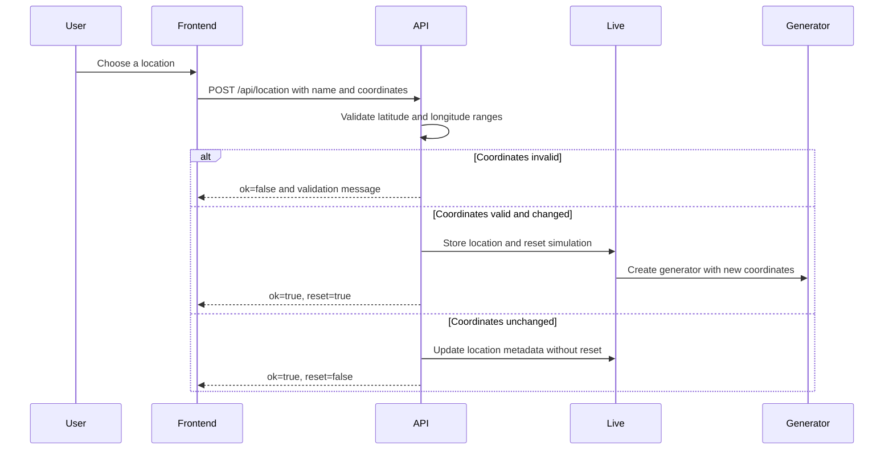

# Application Workflows

This guide follows the main operations through the current code. It is intended to help contributors understand which component initiates an action, which component performs it, and where the resulting state is used.

## 1. Application startup and model readiness

The HTTP service can start before model training finishes. During that interval, status and metrics responses should be interpreted using their readiness fields. A successful HTTP response does not itself prove that inference is ready.

## 2. Background simulation tick and browser polling

The ticker, not the browser, advances the simulation. Browser polling only reads the latest snapshot. This is why opening additional tabs should not make the simulation advance faster.

## 3. Scenario selection

The frontend waits for the backend to confirm the scenario before committing the new selection for API-backed scenarios. The special `offline` demonstration state is handled locally by `useDevice()` and does not post a scenario to the backend.

## 4. Prediction compared with later reality

The final 30 rows are pending because their full outcome windows have not elapsed. They are intentionally excluded from completed prediction-versus-reality counts. This avoids marking a prediction as incorrect merely because the simulation has not yet had time to reveal its outcome.

## 5. Location change

The location is an input to the synthetic generator. It does not initiate a request to a live weather provider.

## 6. Retraining

A retraining request is accepted only when `ULAN_ENABLE_RETRAIN` is enabled. The endpoint checks whether training is already active, starts a worker thread, and returns without waiting for the full training process. When training succeeds, the model bundle is saved and the in-memory model store is updated. The live simulation is reset so subsequent inference uses the newly trained model.

## Workflow maintenance notes

- Keep the ticker as the owner of simulation progression.
- Keep GET handlers observational; do not add hidden state advancement to read routes.
- Keep feature calculations shared between training and inference.
- Preserve the 30-minute maturation delay in prediction-versus-reality evaluation unless the research target itself changes.
- Ensure scenario and location actions update both backend state and frontend state consistently.
- Treat model readiness and API connectivity as separate conditions.
