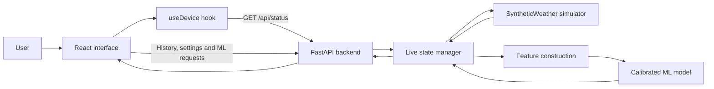
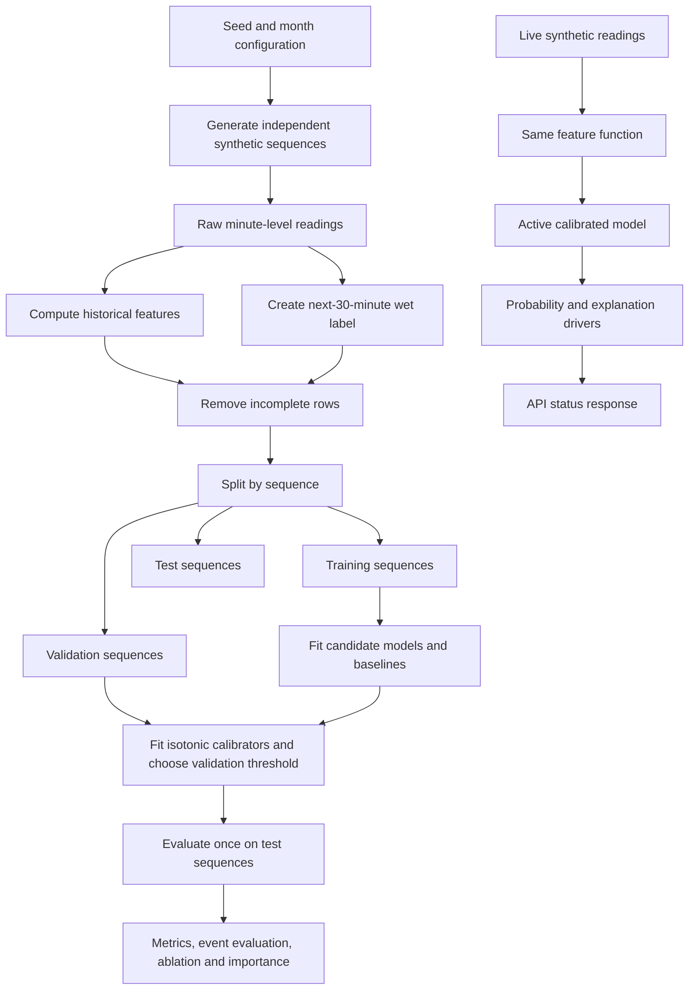
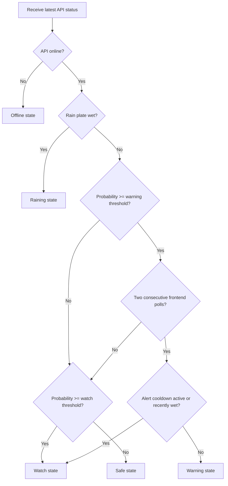
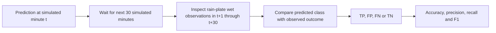

# System Diagrams

These diagrams describe the current repository architecture. They use Mermaid syntax and can be rendered by many Markdown viewers, including GitHub.

## 1. Runtime architecture



The frontend requests data from the backend. The backend advances the synthetic environment, calculates features, obtains model output, and returns the latest state. The browser does not directly run the Python ML model.

## 2. Model development and inference flow



The same feature-construction function is used for offline training and live inference. Validation data is used for calibration; test data is reserved for final reported evaluation.

## 3. Warning-state flow



This is a simplified representation of the frontend state evaluation in `src/useDevice.js`. The backend event-evaluation rule is implemented separately in `backend/ml.py` and should be consulted when interpreting research metrics.

## 4. Prediction-versus-reality maturation



The newest 30 prediction rows are pending because their observation windows have not elapsed. They should not be counted as correct or incorrect yet.

## 5. Source ownership map

| Concern | Main source |
|---|---|
| Application composition and navigation | `src/App.jsx` |
| API polling and frontend warning levels | `src/useDevice.js` |
| Overview composition | `src/components/HomeView.jsx` |
| Simulation state and API routes | `backend/main.py` |
| Synthetic weather behavior | `backend/simulator.py` |
| Feature definitions and target labels | `backend/features.py` |
| Training, calibration and evaluation | `backend/ml.py` |
```
